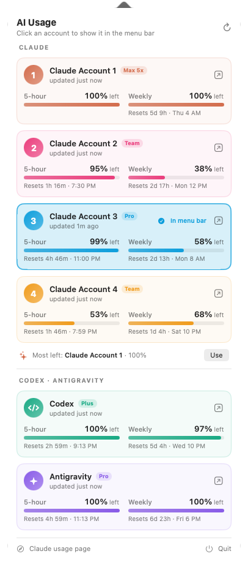

<div align="center">

# AI Usage Bar

**Every AI usage limit you have, in one glance from the macOS menu bar.**

Track several Claude accounts, Codex and Antigravity (Gemini) side by side.<br>
When one account runs out, switch to the next and keep working in the same chats.

[](#install)
[](claude/main.swift)
[](LICENSE)
[](#privacy)
[](https://github.com/emonibnmustafa/AI-UsageBar/stargazers)


<br><br>



[Features](#features) · [Install](#install) · [How it works](#how-it-works) · [Privacy](#privacy) · [FAQ](#faq)

</div>

---

## Why

Heavy AI users hit limits. With two or three Claude accounts plus Codex and Gemini, you end up opening each app, digging for its usage page, and signing in and out to switch.

AI Usage Bar puts every limit in one place and keeps every Claude account signed in at the same time, in its own app.

## Features

| | |
|---|---|
| 📊 **Menu bar gauges** | Ring gauges for the 5-hour and weekly limits of the account you pick, with percentage left and reset time. Orange under 25%, red under 10%. |
| 🗂️ **One panel for everything** | Every account on its own coloured card, with plan, both limits and exact reset times. |
| 👥 **Many Claude accounts, no sign-out** | Each extra account gets its own copy of the Claude app. All of them run at once. |
| 💬 **Shared chats and projects** | Code-tab chats started in any Claude app show up in all of them, under the same project. Continue where the last account stopped. |
| ✨ **Best-account hint** | The panel shows which Claude account has the most left, with a one-click **Use**. |
| 🔄 **Gentle on rate limits** | The menu bar account refreshes about every 2 minutes; the others only when you open the panel. |
| 🤖 **Codex and Antigravity** | ChatGPT Codex and Google Antigravity (Gemini) limits sit next to Claude. |
| 🪶 **Tiny and native** | One Swift file, no Electron, no telemetry. Starts at login. |

## Install

### With your AI agent (recommended)

Open Claude Code, Codex or any coding agent on your Mac and say:

> Install this for me: https://github.com/emonibnmustafa/AI-UsageBar

The agent follows [`.claude/skills/install-ailimitbar/SKILL.md`](.claude/skills/install-ailimitbar/SKILL.md):

1. It asks how many Claude accounts you use and whether you use Codex and Antigravity.
2. It creates one Claude app per extra account and asks you to sign in to each once.
3. It writes your config and installs the menu bar app.

### By hand

**Requirements:** macOS 12+, Xcode command line tools, `jq`, and the Claude desktop app (plus Codex and/or Antigravity if you use them).

```bash
git clone https://github.com/emonibnmustafa/AI-UsageBar.git
cd AI-UsageBar
```

For each extra Claude account (2, 3, …), create its app, then open it, sign in and quit it:

```bash
claude/accounts/make-app.sh "Claude Account 2" com.local.claude.account2 "Claude Account 2"
```

Write your config (edit it to match your accounts) and install:

```bash
mkdir -p ~/.config/ailimitbar && cp accounts.example.json ~/.config/ailimitbar/accounts.json
./install.sh
```

The config format is in the [install skill](.claude/skills/install-ailimitbar/SKILL.md#4-write-the-config). Upgrading account apps made by an older version? Run `claude/accounts/share.sh` once. Remove everything with `./uninstall.sh`.

## How it works

```
 Claude.app ─────────────┐
 Claude Account 2.app ───┤   sign-in tokens       ┌──────────────────────┐
 Claude Account 3.app ───┼── (read locally) ────▶ │  AI Usage Bar        │──▶ menu bar + panel
 Codex ──────────────────┤                        │  each service's own  │
 Antigravity ────────────┘                        │  usage endpoint      │
                                                  └──────────────────────┘
```

- Each extra Claude app is a copy of Claude with its own profile folder and bundle ID, so its sign-in never touches your main app.
- The copies store Code-tab chats in the main app's folder, so every app sees the same chats and projects.
- The bar reads each app's sign-in from its own storage and asks only that service how much is left.

More detail in [claude/README.md](claude/README.md).

## Privacy

- Everything runs on your Mac. There is no server, account or analytics.
- Sign-in tokens are read from each app's own storage, kept in memory, and sent only to that service's own usage endpoint.
- No names or emails are shown or stored.
- The account apps never change or sign out your existing Claude app.

## FAQ

<details>
<summary><b>Does it break when Claude updates?</b></summary>

Your main Claude app updates as usual. The extra account apps are copies; after a big Claude update, rebuild them with `make-app.sh` to pick up the new version. Your sign-ins and chats stay.
</details>

<details>
<summary><b>Can I add or remove an account later?</b></summary>

Yes. Ask your agent to "add a Claude account" or "remove an account", or edit `~/.config/ailimitbar/accounts.json` and run `./install.sh` again.
</details>

<details>
<summary><b>Why not refresh every account all the time?</b></summary>

Claude rate-limits frequent usage checks. Only the account in the menu bar is polled; the rest refresh when you look at them.
</details>

## Repository

| Folder | What |
|---|---|
| [`claude/`](claude) | The menu bar app (`main.swift`) and the account-app scripts (`accounts/`). |
| [`codex/`](codex) | An older standalone Codex bar (context window, low-limit popups). Not installed by `./install.sh`; install it alone with `codex/scripts/install.sh`. |

## Disclaimer

Not affiliated with or endorsed by Anthropic, OpenAI or Google. The usage endpoints it reads are internal to each service and may change with app updates. Use at your own risk and within each service's terms.

## License

[MIT](LICENSE). If it saves you time, a ⭐ helps others find it.
